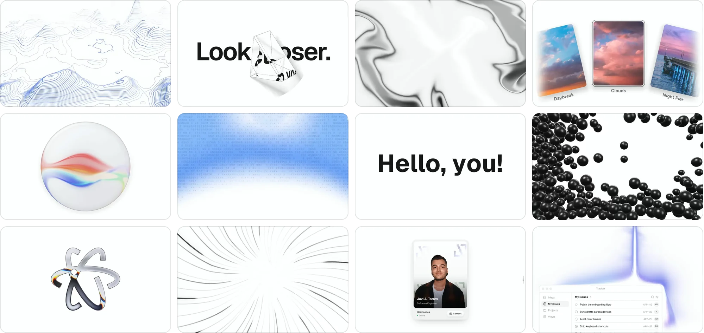
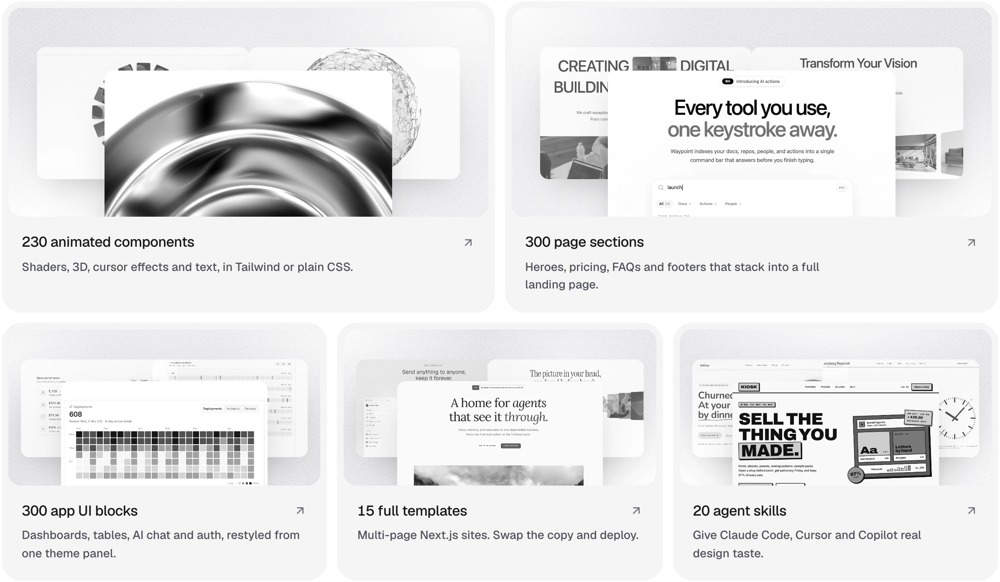
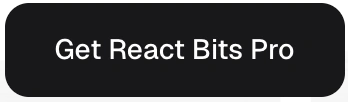
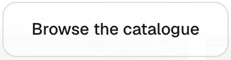
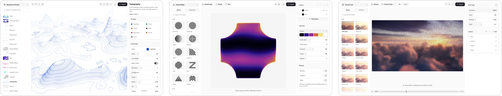
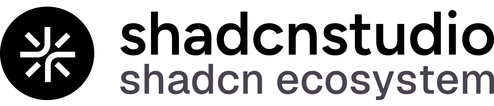

<div align="center">
  <br />
  <picture>
    <source media="(prefers-color-scheme: dark)" srcset="src/assets/logos/reactbits-gh-white.svg">
    <source media="(prefers-color-scheme: light)" srcset="src/assets/logos/reactbits-gh-black.svg">
    
  </picture>
  <br />
  <br />
  <h3>Animated React components for websites people remember.</h3>
  <p>215+ free animated components and backgrounds for React.<br />Tune them yourself, or hand them to your agent.</p>
  <p>
    <a href="https://github.com/davidhdev/react-bits/stargazers"></a>
    <a href="https://github.com/davidhdev/react-bits/blob/main/LICENSE.md"></a>
  </p>
  <p>
    <a href="https://reactbits.dev/get-started/introduction"><strong>Documentation</strong></a> ·
    <a href="https://reactbits.dev/get-started/installation"><strong>Installation</strong></a> ·
    <a href="https://reactbits.dev/get-started/mcp"><strong>MCP</strong></a> ·
    <a href="https://reactbits.dev/tools"><strong>Tools</strong></a> ·
    <a href="https://pro.reactbits.dev/?utm_source=github&utm_medium=readme&utm_campaign=pro-conversion&utm_content=readme-nav"><strong>Pro</strong></a>
  </p>
  <br />
</div>

<a href="https://reactbits.dev">
  <picture>
    <source media="(prefers-color-scheme: dark)" srcset="public/assets/readme/hero-dark.webp">
    <source media="(prefers-color-scheme: light)" srcset="public/assets/readme/hero-light.webp">
    
  </picture>
</a>

## What's inside

Every component has a live demo with controls, and comes in four flavors: JavaScript or TypeScript, styled with CSS or Tailwind.

| Category                                                   | Count | What you'll find                                                  |
| ---------------------------------------------------------- | ----: | ----------------------------------------------------------------- |
| [Text Animations](https://reactbits.dev/c/text-animations) |    33 | Split text, typewriters, rotating words and scroll reveals        |
| [Animations](https://reactbits.dev/c/animations)           |    38 | Cursor effects, hover interactions, borders and image effects     |
| [Components](https://reactbits.dev/c/components)           |    48 | Cards, navigation, carousels and galleries                        |
| [Micro](https://reactbits.dev/c/micro)                     |    34 | Buttons, toggles, indicators and other small interface details    |
| [Backgrounds](https://reactbits.dev/c/backgrounds)         |    63 | Gradients, particles, grids and shader effects for whole sections |

## React Bits Pro

**The complete React toolkit for crafting memorable UI.** React Bits stays free forever. Pro takes you from individual effects to complete pages, product UI, templates and an Agent Kit, all delivered as source you own.

<a href="https://pro.reactbits.dev/?utm_source=github&utm_medium=readme&utm_campaign=pro-conversion&utm_content=readme-pro">
  <picture>
    <source media="(prefers-color-scheme: dark)" srcset="public/assets/readme/pro-dark.webp">
    <source media="(prefers-color-scheme: light)" srcset="public/assets/readme/pro-light.webp">
    
  </picture>
</a>

> "Everything about this is next level." — [@shadcn](https://x.com/shadcn/status/1962854085587275932)
>
> "Paid once, and he keeps shipping updates. Easiest value I've gotten from any tool." — [@juandadotdev](https://x.com/juandadotdev/status/2082117331103162412)

**Pay once, keep every update.** Every file is yours to edit, and lifetime access includes every future update. Want to see how it fits your workflow first? [Grab a free template and agent skill](https://reactbits.dev/pro), no checkout needed.

<p>
  <a href="https://pro.reactbits.dev/?utm_source=github&utm_medium=readme&utm_campaign=pro-conversion&utm_content=readme-pro-cta#pricing">
    <picture>
      <source media="(prefers-color-scheme: dark)" srcset="public/assets/readme/pro-get-dark.webp">
      <source media="(prefers-color-scheme: light)" srcset="public/assets/readme/pro-get-light.webp">
      
    </picture>
  </a>
  &nbsp;
  <a href="https://pro.reactbits.dev/docs/components?utm_source=github&utm_medium=readme&utm_campaign=pro-conversion&utm_content=readme-pro-catalogue">
    <picture>
      <source media="(prefers-color-scheme: dark)" srcset="public/assets/readme/pro-browse-dark.webp">
      <source media="(prefers-color-scheme: light)" srcset="public/assets/readme/pro-browse-light.webp">
      
    </picture>
  </a>
</p>

## Installation

Add any component with the [shadcn](https://ui.shadcn.com/) CLI. The suffix picks the flavor: `JS` or `TS`, then `CSS` or `TW`.

```bash
npx shadcn@latest add @react-bits/SplitText-TS-TW
```

Or with [jsrepo](https://jsrepo.dev):

```bash
npx jsrepo@latest add https://reactbits.dev/r/SplitText-TS-TW
```

Prefer to copy by hand? Open a component's Code tab, pick your flavor and paste the files into your project. The [installation guide](https://reactbits.dev/get-started/installation) covers both.

### Use it with your agent

React Bits works with the shadcn MCP server, so Claude Code, Cursor, Codex, VS Code and Antigravity can find and add components for you. Add the registry to your `components.json`:

```json
{
  "registries": {
    "@react-bits": "https://reactbits.dev/r/{name}.json"
  }
}
```

Then connect your client, for example `npx shadcn@latest mcp init --client claude`, and ask for what you need. See the [MCP guide](https://reactbits.dev/get-started/mcp) for every client.

## Creative tools

Five free tools for making assets and sounds with React Bits, right in the browser.

<a href="https://reactbits.dev/tools">
  <picture>
    <source media="(prefers-color-scheme: dark)" srcset="public/assets/readme/tools-dark.webp">
    <source media="(prefers-color-scheme: light)" srcset="public/assets/readme/tools-light.webp">
    
  </picture>
</a>

- **[Background Studio](https://reactbits.dev/tools/background-studio)**: browse every animated background, start from a preset and tune it live. Export the code, a high-resolution image or a looping MP4 or WebM video.
- **[Center Stage](https://reactbits.dev/tools/center-stage)**: turn a screenshot or screen recording into a polished product shot on lifelike phones, laptops and browsers, with 3D tilt, depth of field, shadows and type. Perfect for launch videos or demos. Export 4K images, 4K video, GIFs or a link.
- **[Shape Magic](https://reactbits.dev/tools/shape-magic)**: design a logo mark from shapes, patterns, text or your own SVG, then give it a 3D material like chrome, glass or neon. Export SVG, PNG, favicons, video or React.
- **[Texture Lab](https://reactbits.dev/tools/texture-lab)**: run photos, videos or your camera through 160 one-click styles and 75+ stackable effects, from ASCII and halftone to glass and glitch. Export images, videos or GIFs.
- **[Sound Lab](https://reactbits.dev/tools/sound-lab)**: audition 200 interface and video sounds, tune them and add effects like reverb, echo and filter, then install one with a single command or download WAV, MP3 or OGG.

## Sponsors

React Bits is supported by these sponsors. [Become a sponsor](https://reactbits.dev/sponsors) to reach 500K+ developers every month.

**Diamond**

<p>
  <a href="https://www.shadcnblocks.com/?utm_source=reactbits&utm_medium=sponsor&utm_campaign=diamond&ref=reactbits">
    <picture>
      <source media="(prefers-color-scheme: dark)" srcset="public/assets/sponsors/shadcnblocks.svg">
      <source media="(prefers-color-scheme: light)" srcset="public/assets/sponsors/shadcnblocks-lightmode.svg">
      
    </picture>
  </a>
  &nbsp;&nbsp;&nbsp;&nbsp;
  <a href="https://shaders.com/?utm_source=reactbits&utm_medium=sponsor&utm_campaign=diamond&ref=reactbits">
    <picture>
      <source media="(prefers-color-scheme: dark)" srcset="public/assets/sponsors/shaders.svg">
      <source media="(prefers-color-scheme: light)" srcset="public/assets/sponsors/shaders-lightmode.svg">
      
    </picture>
  </a>
</p>

**Silver**

<p>
  <a href="https://shadcnuikit.com/?utm_source=reactbits&utm_medium=sponsor&utm_campaign=silver&ref=reactbits">
    <picture>
      <source media="(prefers-color-scheme: dark)" srcset="public/assets/sponsors/shadcnuikit.svg">
      <source media="(prefers-color-scheme: light)" srcset="public/assets/sponsors/shadcnuikit-lightmode.svg">
      
    </picture>
  </a>
  &nbsp;&nbsp;&nbsp;
  <a href="https://shadcnstudio.com/?utm_source=reactbits&utm_medium=sponsor&utm_campaign=silver&ref=reactbits">
    <picture>
      <source media="(prefers-color-scheme: dark)" srcset="public/assets/sponsors/shadcnstudio.svg">
      <source media="(prefers-color-scheme: light)" srcset="public/assets/sponsors/shadcnstudio-lightmode.svg">
      
    </picture>
  </a>
</p>

## Community

**Contributing.** Ideas and fixes are welcome. Browse the [open issues](https://github.com/DavidHDev/react-bits/issues), suggest something with the [feature request template](https://github.com/DavidHDev/react-bits/issues/new?template=2-feature-request.yml), and read the [contribution guide](https://github.com/DavidHDev/react-bits/blob/main/CONTRIBUTING.md) before opening a pull request.

**Official ports.** React Bits is also available for [Vue](https://vue-bits.dev/) and [Svelte](https://sveltebits.xyz/).

**Contributors.** Thanks to everyone who has helped build React Bits.

<a href="https://github.com/davidhdev/react-bits/graphs/contributors">
  
</a>

<br />
<br />


## Credit

React Bits occasionally draws inspiration from publicly available code examples. These are rewritten as full-fledged, customizable components for JS, TS, CSS and Tailwind. If you recognize your work, [open an issue](https://github.com/DavidHDev/react-bits/issues) to request credit.

Some Texture Lab effects and Shape Magic materials are adapted from [Paper Shaders](https://shaders.paper.design) (Apache 2.0) and [Shaders.com](https://shaders.com) by Shader Effects Inc. (MIT). The third-party notices for [Texture Lab](src/tools/texture-lab/THIRD_PARTY_NOTICES.md) and [Shape Magic](src/tools/shape-magic/THIRD_PARTY_NOTICES.md) list the adapted files and include the licenses.

## License

[MIT + Commons Clause](https://github.com/davidhdev/react-bits/blob/main/LICENSE.md), free for personal and commercial use. Created and maintained by [David Haz](https://github.com/DavidHDev).
